# Brushless Motor Tester with Arduino

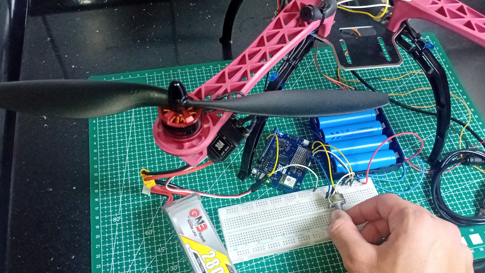

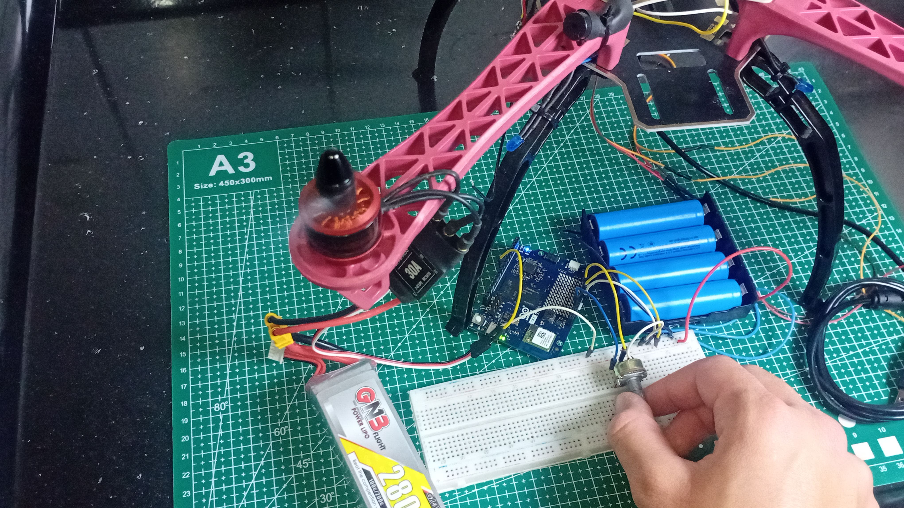

*I've recently posted a tutorial about this project on YouTube. You can watch it [here](https://www.youtube.com/).*

A simple and inexpensive way to test brushless DC motors (BLDC) using an Arduino board, a potentiometer, and an electronic speed controller (ESC).

This project allows you to control the motor speed directly from a potentiometer, making it useful for testing motors during drone development and other electronics projects.

The system uses an Arduino to read the potentiometer position and generate control pulses for the ESC using the Arduino Servo library.

## Components

You'll need the following components:

- Arduino UNO Q (or a compatible Arduino board with 3.3V analog inputs)
- 10kΩ potentiometer
- Breadboard
- 30A ESC (or another ESC compatible with your motor)
- LiPo battery compatible with the ESC
- Battery holder for four 18650 Li-ion cells
- Four 18650 Li-ion batteries
- Brushless DC motor
- Jumper wires

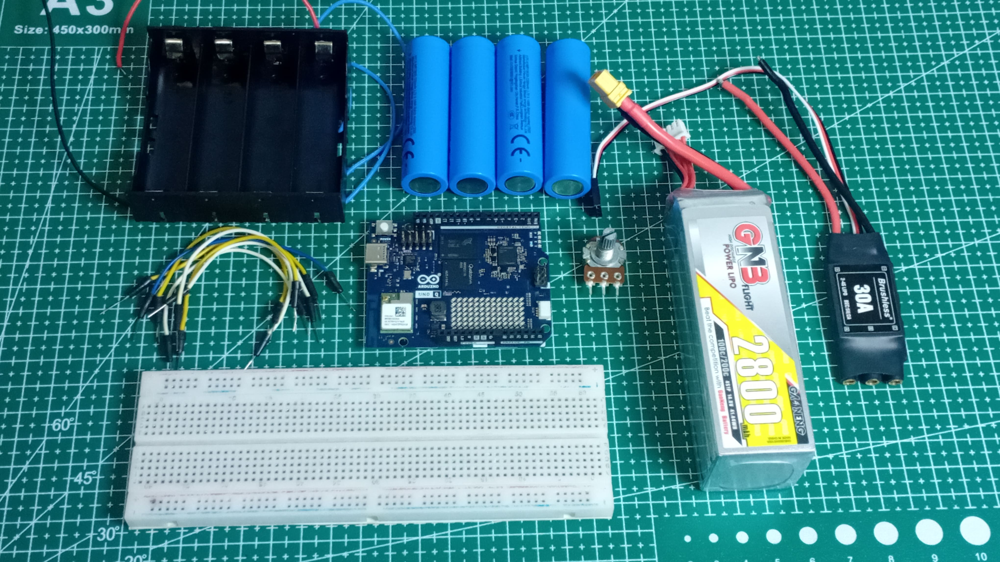

## Wiring

Connect the components according to the following schematics:

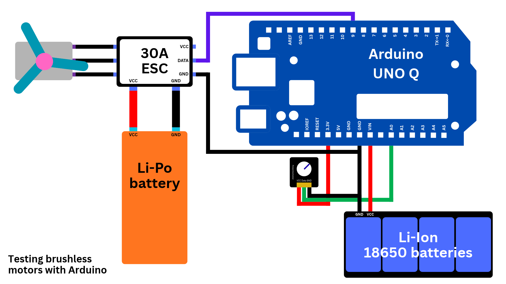

### Potentiometer

| Potentiometer | Arduino UNO Q |
|---|---|
| First outer leg | 3.3V |
| Middle leg | A0 |
| Last outer leg | GND |

### ESC

| ESC wire | Arduino UNO Q |
|---|---|
| White (signal) | Digital pin 9 |
| Black (ground) | GND |

Connect the ESC's power wires to the LiPo battery. The battery holder powers the Arduino through VIN and GND.

> [!IMPORTANT]
> The Arduino and ESC must share a common ground for the control signal to work correctly.
>
> Check the ESC wiring instructions before connecting anything.

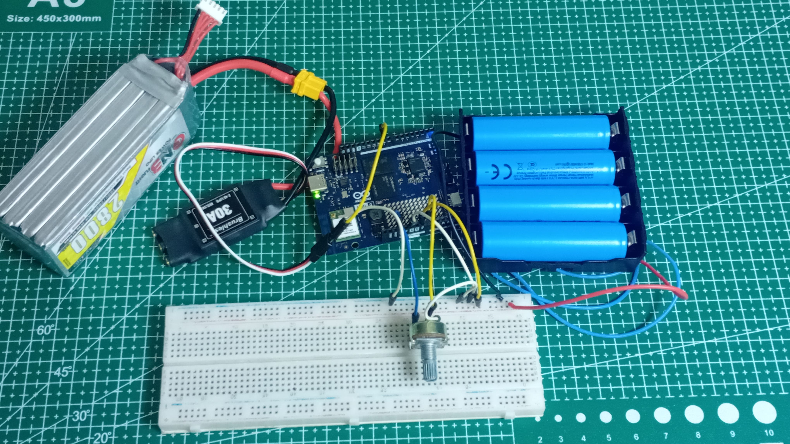

### Battery

This project uses two different battery configurations:

- **LiPo battery:** Powers the brushless motors through the ESC.
- **Li-ion batteries:** Four 18650 Li-ion cells connected in series using a battery holder to power the Arduino UNO Q through its VIN pin.

Note that the four 18650 cells connected in series provide approximately 14.8V nominally and 16.8V when fully charged.

    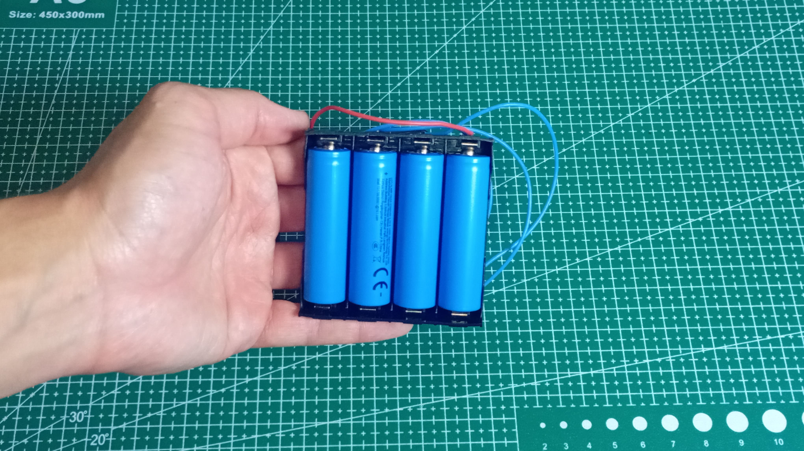
    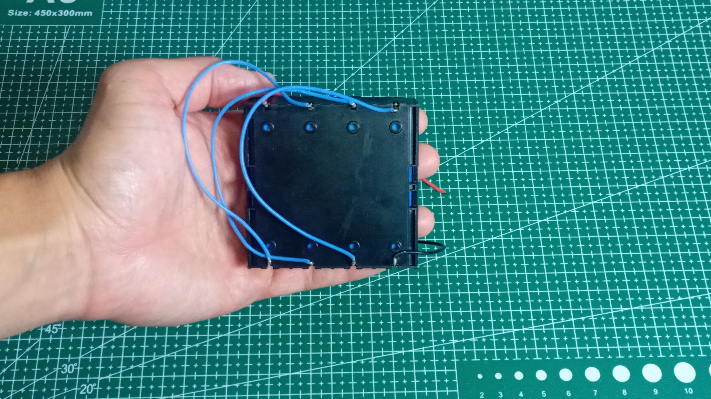

 

> [!WARNING]
> The [Arduino UNO Q](https://docs.arduino.cc/hardware/uno-q/) supports an input voltage between **7V and 24V through its VIN pin**. Always make sure your battery voltage is within the supported range of the board (or microcontroller) you are powering.
>
> Remember that battery voltage changes depending on its charge level. Always consider the maximum fully charged voltage, not just the nominal voltage, when selecting your power supply.

Check the wiring schematic included in this repository for a complete overview of the connections.

## Arduino Sketch

The project includes the following sketch:

`test_brushless_motors.ino`

The code uses the Arduino Servo library to generate control pulses for the ESC through the `writeMicroseconds()` function.

The potentiometer reading is converted into a pulse width:

- **1000 µs:** Minimum throttle
- **1300 µs:** Maximum throttle

The throttle range is intentionally limited to provide a conservative starting point for motor testing.

### Uploading the Code

1. Install the [Arduino IDE](https://www.arduino.cc/en/software).
2. Install the Servo library.
3. Install the Arduino UNO Q board support.
4. Open `test_brushless_motors.ino`.
5. Select your Arduino board and the correct port.
6. Upload the sketch.

Once uploaded, open the Serial Monitor at **115200 baud** to monitor the potentiometer readings and throttle pulse width.

The sketch keeps the ESC command at minimum throttle during startup and waits five seconds before allowing potentiometer control.

## How to Use

1. Remove the propeller from the brushless motor.
2. Securely attach the motor to a stable structure.
3. Connect the motor to the ESC.
4. Set the potentiometer to its minimum position.
5. Power the Arduino and ESC.
6. Wait for the ESC initialization sequence to finish.
7. Slowly rotate the potentiometer to increase the motor speed.

The motor speed increases as you turn the potentiometer.

If the motor spins in the wrong direction, disconnect the power and swap any two of the three motor wires.

    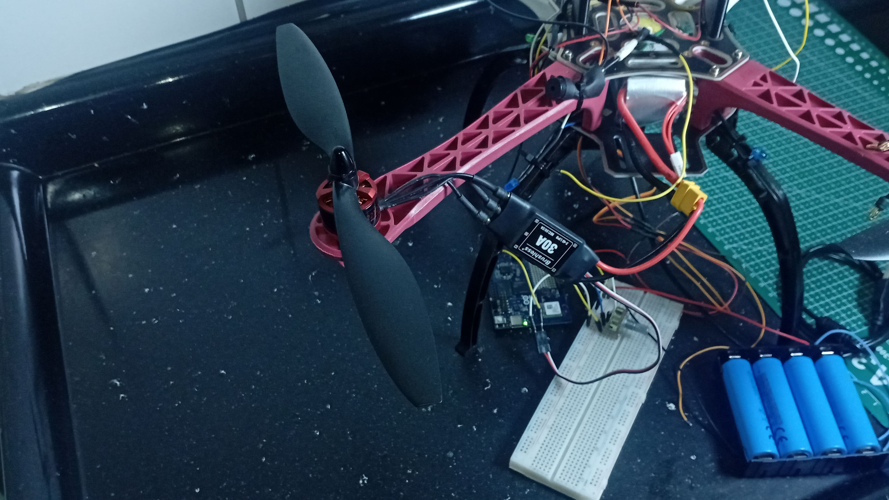
    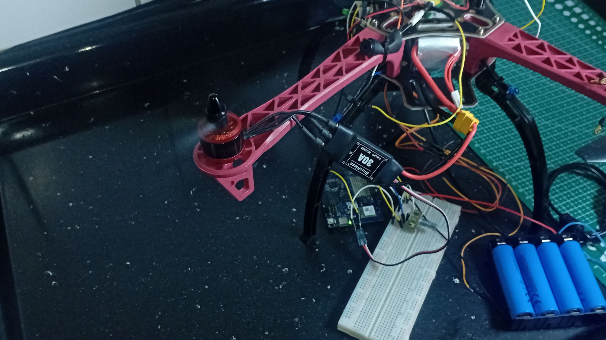

 

## Safety Precautions

> [!CAUTION]
> A brushless motor can generate significant force even at relatively low throttle settings. Always take appropriate safety precautions.

- **Always remove the propeller** when testing brushless motors.
- Secure the motor firmly before powering it on.
- Keep your hands and other objects away from rotating parts.
- Make sure the ESC, battery, and motor are electrically compatible.
- Never connect more than 3.3V to the Arduino UNO Q's GPIO and analog input pins.
- Check battery polarity before connecting the power supply.
- Never exceed the voltage limits of the Arduino board or ESC.
- Use appropriate battery protection and charging equipment.

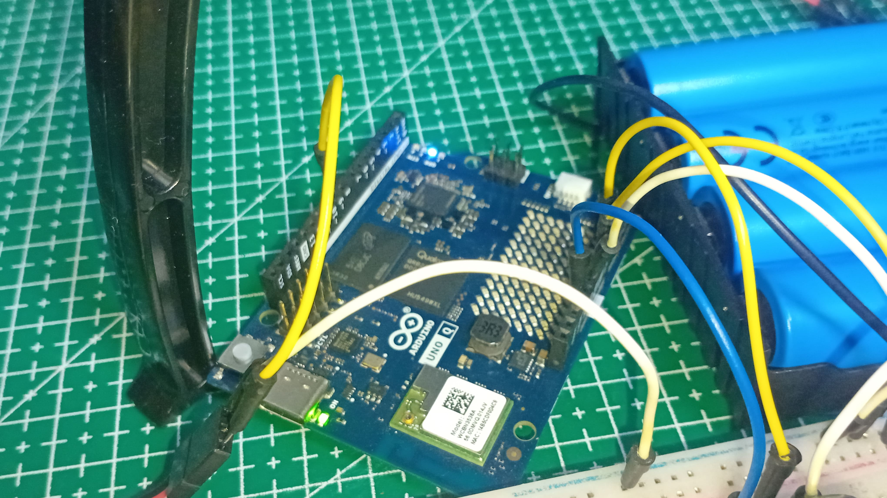

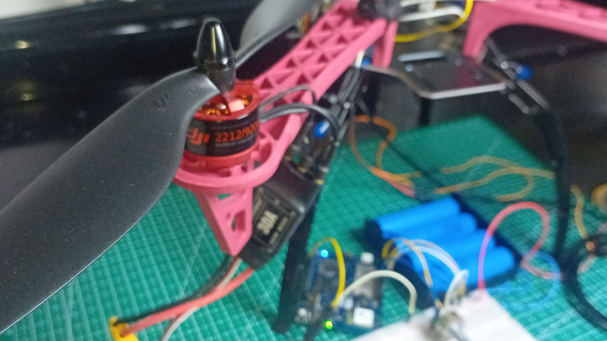

## Repository Contents

- `test_brushless_motors.ino` – Arduino sketch.
- `schematics/` – Circuit wiring diagrams.

## License

Feel free to use, modify, and adapt this project for your own electronics and robotics projects.
